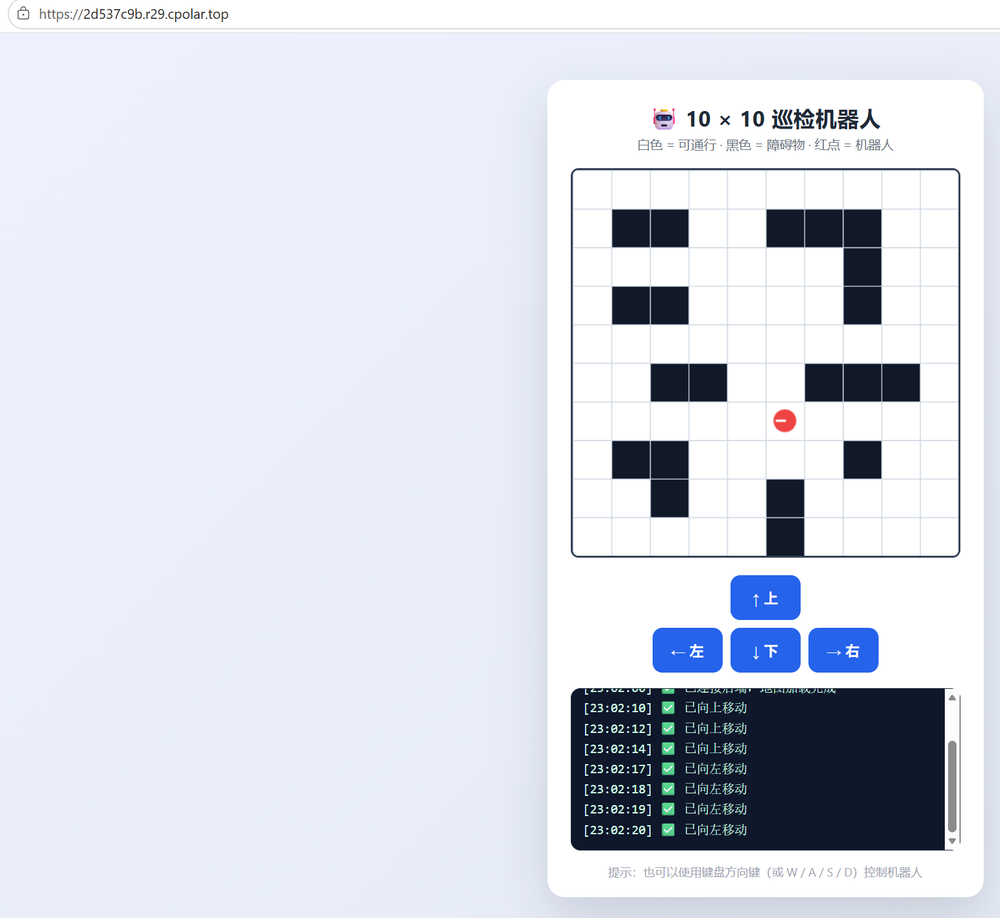

# 10x10 智能巡检机器人仿真系统

## 在线演示地址
[点击这里体验]https://2d537c9b.r29.cpolar.top/

## 项目简介
本项目是基于 Web 的 2D 巡检机器人仿真。用户可以在网页端查看 10x10 的二维地图，通过按钮或键盘控制机器人移动，并实时观察坐标和状态反馈。

## 运行说明
本项目已通过 Docker 容器化。
启动命令：`docker compose up -d`
访问地址：`http://localhost:5000`

## 团队分工
*   温文静：个人独立完成
## 项目架构图
```mermaid
graph TD
    A[用户浏览器 (HTML5 Canvas)] -->|HTTP 请求 (GET/POST)| B(Flask 后端 API)
    B -->|更新/获取状态| C{全局状态 (坐标/地图)}
    B -->|容器化部署| D[Docker 容器]
    A -->|内网穿透| E[cpolar 公网访问]
    ## 成果展示
